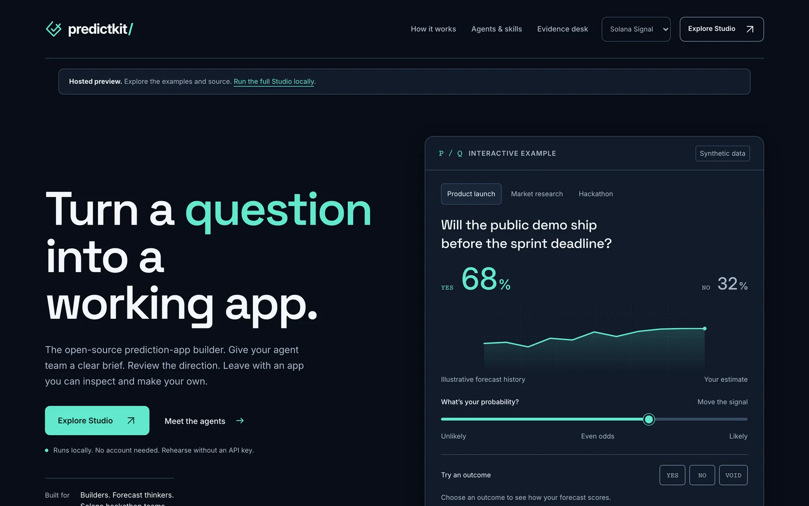

# PredictKit

**One brief. Eight visible roles. A prediction prototype you can inspect.**

<p>
  <a href="https://predictkit-j12zey1eu-megandmartins-projects.vercel.app"><strong>Try the hosted preview</strong></a> ·
  <a href="#run-locally">Run locally</a> ·
  <a href="docs/HOW_PREDICTKIT_WORKS.md">How it works</a>
</p>

<a href="https://predictkit-j12zey1eu-megandmartins-projects.vercel.app"></a>

An MIT-licensed local builder studio with a Solana-inspired interface, explicit approval gates, role-scoped skills and inspectable evidence. Start free with scripted rehearsal; configure an API model only when you choose to.

## Run locally

Python 3.11+ is the only requirement for the Studio. No Python packages or API key are needed for rehearsal.

```bash
git clone https://github.com/megandmartin/predictkit.git
cd predictkit
python3 predictkit.py doctor
python3 predictkit.py serve --open
```

Open `http://127.0.0.1:8765`. Choose **Open Studio**, review the example brief, start a rehearsal, approve its exact build memo, inspect the generated app and export the pack. The rehearsal uses scripted outputs and writes real local files.

## Explore

- **Studio:** a fixed eight-role workflow with three concurrent workers, exact memo approval and role-owned outputs.
- **Skills:** inspect every role prompt, eight mapped skills, two operator guides, input contracts and review questions.
- **Examples:** forecast, close, resolve YES/NO/VOID and inspect calibration. Browser simulations; no real-money trading.
- **Solana demo:** a recorded create → forecast → resolve flow from a compiled program executed in an isolated local SVM.
- **Evidence:** distinguish local tests, provider usage, chain verification and builder outcomes.

The hosted Vercel preview presents the design, interactive examples, source-backed skill catalog and recorded Solana execution. Run the Python Studio locally to schedule roles, save artifacts or configure a paid API run. The hosted preview has no accounts, API keys, Python worker service or wallets.

Codex and Claude can help develop this repository. They are not installed runtime workers: live mode uses direct OpenAI Responses requests with one operator-configured model. Global design skills are separate from PredictKit's bundled role skills.

## Verification

```bash
python3 -m unittest discover -s tests -v
node --test solana/tests/codec.test.mjs
python3 predictkit.py rehearse
python3 scripts/build_site.py
python3 scripts/package_source.py
python3 scripts/verify_source_package.py
```

Node 20+ is needed only for optional JavaScript checks. [Publication verification](evidence/PUBLICATION.md) records the checks and their limits. [Local SVM guide](solana/LOCAL_SVM_GUIDE.md) explains the separate compiler and optional dependencies needed to reproduce program execution.

## Current boundaries

The Responses adapter is implemented and tested offline; genuine paid generation has not yet been verified. The registry has compiled and passed 28 local SVM tests; no public deployment or wallet connection is claimed. Three independent builder sessions are still pending. This is a development preview, not a production exchange or validated workshop.

Read [Start here](START_HERE.md), [how it works](docs/HOW_PREDICTKIT_WORKS.md), [live setup](docs/LIVE_RUN.md), [capability contracts](docs/CAPABILITY_CONTRACT.md) and [hosting](docs/HOSTING.md). The [three-builder pilot](workshop/THREE_BUILDER_PILOT.md) is a test protocol, not completed participant evidence.

License: [MIT](LICENSE). Bundled fonts retain their [SIL OFL notices](THIRD_PARTY_NOTICES.md). Keep private runs, credentials and build caches out of source control. Public source publication does not authorize paid runs, wallet actions or competition submission.
