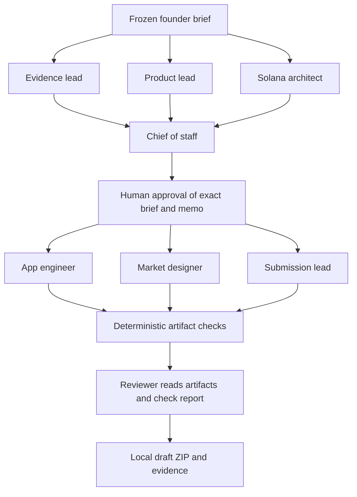

# How PredictKit works

PredictKit runs a fixed, local Python workflow that turns a brief into a forecast-app prototype and a draft evidence pack. Its eight “agents” are eight role instructions and output contracts. In live mode, the coordinator sends each role to the same model you explicitly select; the model does not run the coordinator.

This explanation describes the source in this checkout on 28 September 2026. See the [implementation status](IMPLEMENTATION_STATUS.md) and [capability verification](../evidence/PUBLICATION.md) for what has actually been tested.

## Local setup and coding assistants

Keep this folder together and run these commands from it with Python 3.11 or newer:

```sh
python3 predictkit.py doctor
python3 predictkit.py serve --open
```

The standard-library Python server opens the homepage at `http://127.0.0.1:8765`; choose **Open Studio** or visit `/studio`. No Python package installation, API key or model subscription is needed for the default rehearsal. Run records stay under `.local/runs/`; Ctrl-C stops the server. [Launcher source](../predictkit.py) · [Server source](../predictkit/server.py)

You can open the folder in Codex or Claude and ask that assistant to inspect, edit, test and launch it using the assistant's available tools. [The local continuation prompt](../prompts/START_LOCAL.md) supplies the project handoff. That development conversation is separate from the Studio's eight-role runtime: PredictKit has no implemented Codex worker, Claude worker or subscription-login provider. It does not reuse that conversation or automatically consume that assistant's subscription. The current live adapter expects its own `OPENAI_API_KEY` and configuration. [Provider source](../predictkit/http_provider.py) · [Runtime decision](RUNTIME_DECISION.md)

| Mode | What runs | What it establishes |
|---|---|---|
| Default local rehearsal | Real scheduling, approval, validation and file writes; scripted role outputs | The local workflow can run. It does not establish AI generation or a real model review. |
| Live OpenAI API | Eight separate Responses API requests on a successful full sprint; one selected model with different role instructions | Recorded provider responses and generated artifacts, when a real run succeeds. It does not establish browsing, code execution, chain activity or product correctness. |
| Codex/Claude development session | Your coding assistant edits and tests the repository using its own available tools | Engineering work on PredictKit. This is not a runtime provider option inside the Studio. |

Live mode is opt-in: model, verified token rates, budget and a key must be configured, and the Studio requires paid-run approval. There is no default live model. See the [exact live-run setup](LIVE_RUN.md); `.env.example` is a reference and is not automatically loaded. Local cost estimates are not a provider billing cap. No live API call was made to create this explanation.

## The default workflow



The discovery trio runs concurrently, then the chief synthesizes it. After approval, the three build roles run concurrently, followed by static checks and the reviewer. The default concurrency limit is three. The graph is deterministic Python, not an AI chief dispatching arbitrary workers. Each successful sprint makes one provider invocation per role, with no automatic retry. [Scheduler source](../predictkit/runtime.py)

Parallel siblings receive frozen inputs; they do not read each other's unfinished work. Downstream roles receive selected accepted artifacts after hash checks. The reviewer receives the generated HTML and the static verification report, but has no execution tools. “Independent reviewer” denotes a separate role request; it is not a different model, a security audit or an independent human review.

## The eight roles and their instructions

Role names and output ownership come from [contracts.py](../predictkit/contracts.py); skill assignments come from [skills.py](../predictkit/skills.py). Each role link opens its complete prompt, and each skill link opens the full `SKILL.md`.

| Role and exact prompt | Main job | Skills appended in live mode | Allowed output files |
|---|---|---|---|
| [Evidence lead](../agents/research.md) | Separate supplied evidence from hypotheses | [frame-opportunity](../skills/frame-opportunity/SKILL.md), [collect-evidence](../skills/collect-evidence/SKILL.md) | `research/market.md` |
| [Product lead](../agents/product.md) | Define one useful journey and acceptance criteria | [frame-opportunity](../skills/frame-opportunity/SKILL.md), [specify-market](../skills/specify-market/SKILL.md) | `product/spec.md` |
| [Solana architect](../agents/architect.md) | Specify architecture and integration blockers | [select-solana-adapter](../skills/select-solana-adapter/SKILL.md), [specify-market](../skills/specify-market/SKILL.md) | `architecture/plan.md` |
| [Chief of staff](../agents/chief.md) | Recommend a bounded decision for founder approval | [parallel-build](../skills/parallel-build/SKILL.md) | `decisions/build-memo.md` |
| [App engineer](../agents/frontend.md) | Adapt a self-contained browser reference app | [build-prediction-ui](../skills/build-prediction-ui/SKILL.md), [parallel-build](../skills/parallel-build/SKILL.md) | `app/index.html` |
| [Market designer](../agents/domain.md) | Define the question and YES/NO/VOID rules | [specify-market](../skills/specify-market/SKILL.md), [verify-outcome](../skills/verify-outcome/SKILL.md) | `app/market.json`, `domain/resolution.md` |
| [Submission lead](../agents/submission.md) | Draft pitch, demo and application with missing-evidence flags | [prepare-submission](../skills/prepare-submission/SKILL.md), [collect-evidence](../skills/collect-evidence/SKILL.md) | `submission/pitch.md`, `submission/demo.md`, `submission/application.md` |
| [Independent reviewer](../agents/reviewer.md) | Identify contradictions and missing proof | [verify-outcome](../skills/verify-outcome/SKILL.md), [collect-evidence](../skills/collect-evidence/SKILL.md) | `qa/review.md` |

Two additional packaged guides are for an operator or coding assistant: [run-workshop](../skills/run-workshop/SKILL.md) and [continue-sprint](../skills/continue-sprint/SKILL.md). Neither is assigned to a runtime role. There are ten packaged skill files, of which eight are currently used by live request assembly.

## What a skill actually does

A skill is text with a trigger, inputs, procedure, completion test and boundaries. For example, `specify-market` asks for exact closing and observation times, an authoritative source, dispute rules and VOID conditions. That text guides the model; it cannot fetch evidence, execute a test or authorize a settlement.

For each live role, the adapter assembles:

1. The shared [AGENTS.md](../AGENTS.md) contract and its fixed project context: `PROJECT.md`, `SOUL.md` and `docs/IMPLEMENTATION_STATUS.md`.
2. That role's `agents/<role>.md` prompt.
3. Only the skills assigned in `ROLE_SKILLS`.
4. Its executable capability profile, allowed output paths and strict response schema.
5. The frozen brief and selected accepted artifacts; the app engineer also receives the reference HTML.

The requests are stateless: there is no session or earlier response ID carried forward. Selected files carry context between roles. `store: false` is sent, which is not a blanket promise about all provider retention. The coordinator records the prepared context before dispatch. Successful provider responses carry an assembled-request receipt with hashes of the actual instruction files, full instructions, input and schema; the frontend receipt also identifies its rendered reference app. These records identify what was sent, not whether the model followed it. [Request assembly](../predictkit/http_provider.py) · [Skill loader](../predictkit/skills.py)

Rehearsal uses hard-coded output templates and does not call that skill loader. Viewing a skill in the Studio catalog proves that the file is available; it does not prove a model ran, followed it or met its completion test. The [catalog source](../predictkit/catalog.py) exposes only the allowlisted packaged role and skill files, with SHA-256 hashes for skills; it does not read credentials, run records or arbitrary requested filenames.

Impeccable and Emil's design guidance are available to the development assistant on this laptop. They are not included in PredictKit's role mapping or automatically bundled into its generated-app requests. The app engineer currently receives `build-prediction-ui`, `parallel-build`, its role prompt, the shared contract and reference HTML. To add further guidance later, deliberately review and package suitable instructions, map them to the role, test the request assembly and record the change; a global installation alone does not integrate it.

## Inspecting capabilities and run records

Open `/skills` to see each role's purpose, example assignment, exact inputs and owned outputs, primary skill owner, static checks and questions that require human judgment. Source disclosures contain the real packaged instructions. The same data is available without a server or model call:

```sh
python3 predictkit.py capabilities
python3 predictkit.py capabilities frontend
```

In Studio, select a role to inspect its prepared input record and output-check results. New runs store these records; older runs explicitly show when records are unavailable. A rehearsal never claims to have assembled or executed model instructions.

The coordinator rejects role outputs before publication when their checks fail. Market JSON must preserve the approved question and resolution/VOID rules exactly; the generated app must pass the documented structural/resource indicators. Markdown checks remain structural: thoughtful judgment is evaluated separately. The [capability contract](CAPABILITY_CONTRACT.md) explains these limits and exported-record verification.

## Capability boundaries and next gates

The live model has no search, browser, shell, filesystem or wallet tools. It returns structured text; Python validates and writes the allowed files. Generated HTML is previewed in a restricted browser iframe, while the server never executes generated code. Static checks establish artifact contracts, not browser behavior or settlement correctness. Nothing in this workflow automatically publishes, submits, trades or deploys. [Operating contract](../AGENTS.md) · [Architecture](ARCHITECTURE.md) · [Provider source](../predictkit/http_provider.py)

The next three improvements are: capture one deliberately authorized live run and independently test its generated app; connect the locally SVM-tested registry to the app under explicit network and wallet controls; and observe three fresh builders completing the local journey. These remain distinct changes with their own verification evidence.
